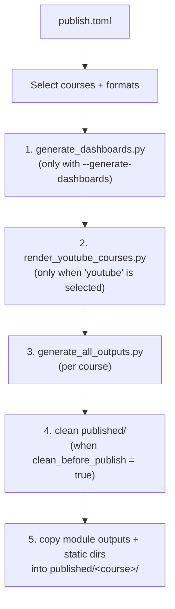

# Publishing Pipeline

> **Navigation**: [← Docs Index](README.md) | [Quick Start](QUICKSTART.md) | [Configuration](CONFIGURATION.md) | [Orchestration](ORCHESTRATION.md) | [CLI Reference](CLI_REFERENCE.md)

This guide describes the **end-to-end run** of the repository: how `publish.py` reads
`publish.toml`, drives the rendering engine, and populates the `published/` tree. For the
configuration schema see [CONFIGURATION.md](CONFIGURATION.md); for composing individual
modules see [ORCHESTRATION.md](ORCHESTRATION.md).

---

## Entry Points

| Entry point | Location | Scope |
| :--- | :--- | :--- |
| `publish.py` | repo root | Full pipeline: select courses, render, clean, and copy to `published/`. |
| `software/scripts/generate_all_outputs.py` | `software/` | Render one course into per-module `output/` directories only. |
| `software/scripts/*.py` | `software/` | Focused tools (single formats, translation, YouTube, validation). |

`publish.py` is intentionally outside the `software/` project, so it runs with plain
`python` (it only needs the standard library plus the `software/` package on `sys.path`).
Engine commands run through `uv run` from `software/`. See the
[CLI Reference](CLI_REFERENCE.md) for every script.

---

## Stage Order

`python publish.py` performs these stages in order:



| Stage | Command | Notes |
| :--- | :--- | :--- |
| 1. Dashboards | `scripts/generate_dashboards.py` | Optional; failures are warnings, not aborts. |
| 2. YouTube scaffold | `scripts/render_youtube_courses.py --force-scaffold --skip-render --skip-whisper` | Only when `youtube` is enabled; injects real transcripts before rendering. |
| 3. Generate | `scripts/generate_all_outputs.py --course <id> --formats <list>` | One subprocess per course; a non-zero exit aborts the run. |
| 4. Clean | (in-process) | Deletes top-level entries of `published/` that do **not** start with `.`. |
| 5. Copy | (in-process) | Copies each module's `output/` plus `dashboard.html` and configured `static_dirs`. |

`.github/workflows/ci.yml` does **not** run this pipeline; it runs lint, the no-mocks
check, and the test suite.

---

## Common Commands

```bash
# Preview everything the current publish.toml would generate
python publish.py --dry-run

# Full run using publish.toml
python publish.py

# One course, quick text + markdown only
python publish.py --course ai-philosophy --override-formats txt,md

# Re-copy existing outputs without regenerating
python publish.py --publish-only
```

All flags are parsed in `publish.py` (`--dry-run`, `--course`, `--override-formats`,
`--skip-clear`, `--no-website`, `--skip-labs`, `--generate-dashboards`, `--publish-only`,
`--verbose`).

---

## Output Layout

Rendered material is collected under the `output_dir` from `publish.toml`
(`published/` by default):

```text
published/
├── AGENTS.md                     # guide for this generated tree
├── <course-id>/
│   ├── <module>/                 # one directory per module
│   │   ├── module.pdf / .docx / .html / .txt / .md
│   │   ├── questions.* / practice_quiz.*
│   │   └── dashboard.html
│   └── <unit>/<module>/          # two-level courses keep the unit level
└── <course-id>/<static_dir>/     # copied verbatim from COURSE_REGISTRY
```

The `published/` subdirectories are generated; edit the Markdown sources in
`course_development/` and re-run the pipeline instead of editing rendered files.

---

## Offline vs. Network Requirements

| Stage or format | Requirement |
| :--- | :--- |
| `txt`, `md`, `html`, `docx` | Fully offline once `uv sync` has completed. |
| `pdf` | System libs (Cairo/Pango); see [QUICKSTART.md](QUICKSTART.md). |
| `mp3` | Network access for gTTS (disabled by default in `publish.toml`). |
| YouTube scaffold | Existing transcript files; no network with `--skip-whisper`. |
| Translation / LLM enrichment | A running Ollama server with the configured model. |

A `--dry-run` preview needs no network and renders nothing.

---
*Last Updated: 2026-11-11*
